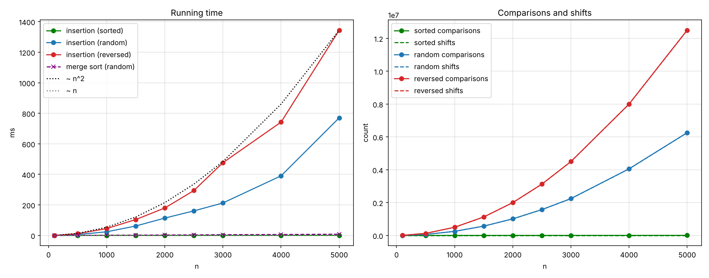

# Insertion Sort - Report

## What I tested
I ran insertion sort on three kinds of input:
- already sorted (best case)
- random (average case)
- reversed (worst case)

Sizes were 100, 500, 1000, 1500, 2000, 2500, 3000, 4000 and 5000. Each time is the average of 3 runs. Merge sort was run on random data as a reference.

## Results (n = 5000)

| input | comparisons | shifts | time |
|---|---|---|---|
| sorted | 4,999 | 0 | ~0.4 ms |
| random | ~6,250,000 | ~6,250,000 | ~770 ms |
| reversed | 12,497,500 | 12,497,500 | ~1340 ms |
| merge sort (random) | - | - | ~8 ms |

These match the theory:
- sorted: n - 1 comparisons and no shifts, so it is linear O(n)
- reversed: n(n-1)/2 comparisons and shifts, O(n^2)
- random: about n^2/4, which is roughly half of the worst case, still O(n^2)

The time numbers depend on the machine but the shape of the curves stays the same.

## Insertion sort vs merge sort

| | insertion sort | merge sort |
|---|---|---|
| best case | O(n) | O(n log n) |
| average | O(n^2) | O(n log n) |
| worst | O(n^2) | O(n log n) |
| extra memory | O(1) | O(n) |
| stable | yes | yes |

## Conclusion
Insertion sort is good when the list is small or almost sorted, because it has almost no overhead and on sorted data it is linear. Once n gets into the thousands with random or reversed data it becomes very slow, at n = 5000 merge sort was around 100 times faster on random input.
