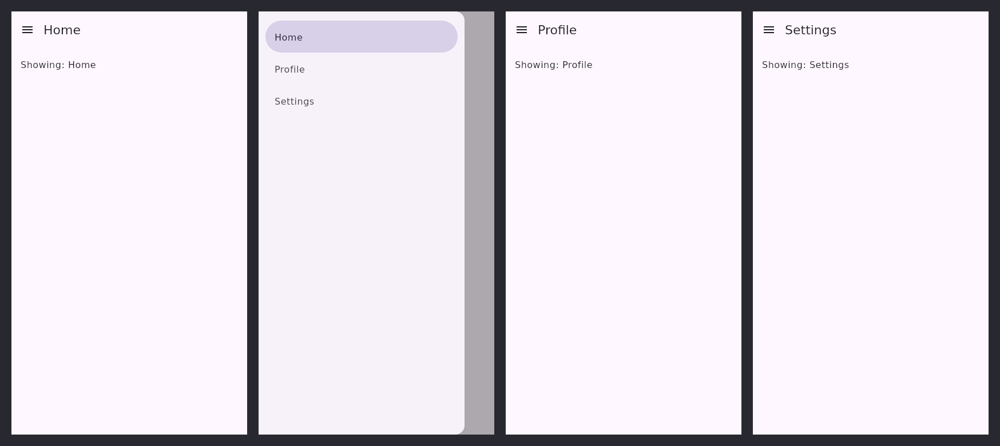

# Task 5 - Navigation Drawer (Jetpack Compose, Material 3)

تطبيق فيه قايمة جانبية (Navigation Drawer) بـ 3 صفحات: Home و Profile و Settings.



من الشمال لليمين: البداية على Home ← دوسة على ☰ بتفتح الـ drawer ← اختيار Profile ← اختيار Settings.

## شرح الكود

| الجزء | بيعمل إيه |
|---|---|
| `MainActivity` + `setContent` | أول شاشة في التطبيق، وبتعرض الـ Compose UI جوه `MaterialTheme` |
| `rememberDrawerState(Closed)` | بيحفظ حالة الـ drawer (مفتوح/مقفول)، وبيبدأ مقفول |
| `rememberCoroutineScope()` | `open()` و`close()` دوال suspend (بيعملوا animation)، فلازم يتنادوا جوه `scope.launch { }` |
| `items` + `selectedItem` | لستة الصفحات، والصفحة المختارة محفوظة في `mutableStateOf`. أي تغيير فيها بيرسم الشاشة من جديد (recomposition) |
| `ModalNavigationDrawer` | الـ drawer اللي بيظهر فوق المحتوى ومعاه خلفية غامقة (scrim). بياخد `drawerContent` والمحتوى الأساسي |
| `ModalDrawerSheet` + `NavigationDrawerItem` | العناصر اللي جوه القايمة. `selected` بيلوّن العنصر المختار، و`onClick` بيغير الصفحة ويقفل الـ drawer |
| `Scaffold` + `TopAppBar` | الشاشة الأساسية: شريط فوق فيه أيقونة ☰ (بتفتح الـ drawer) وعنوانه هو اسم الصفحة المختارة |
| `Column` + `Text("Showing: …")` | محتوى الصفحة. `innerPadding` بيمنع إن المحتوى يتغطى تحت الـ TopAppBar |

الفكرة الأساسية: الحالة (`selectedItem` و`drawerState`) هي اللي بتحدد شكل الشاشة. الضغط على أي عنصر بيغير الحالة، وCompose بيعيد رسم الأجزاء اللي اتأثرت لوحده.

## الملفات
- `app/` مشروع Android. الكود الأصلي متقسم على ملفين: `MainActivity.kt` و`ui/NavigationDrawerExample.kt`
- `desktop-preview/` بيشغّل **نفس ملف** `NavigationDrawerExample.kt` على Compose Desktop، وفيه UI test بيدوس على الزراير وياخد الـ screenshots

## التشغيل
```bash
# الاختبار + الـ screenshots (مش محتاج Android SDK)
./gradlew :desktop-preview:test        # الصور بتتحفظ في screenshots/

# تطبيق Android (محتاج Android SDK: ANDROID_HOME أو local.properties)
./gradlew :app:installDebug
```
